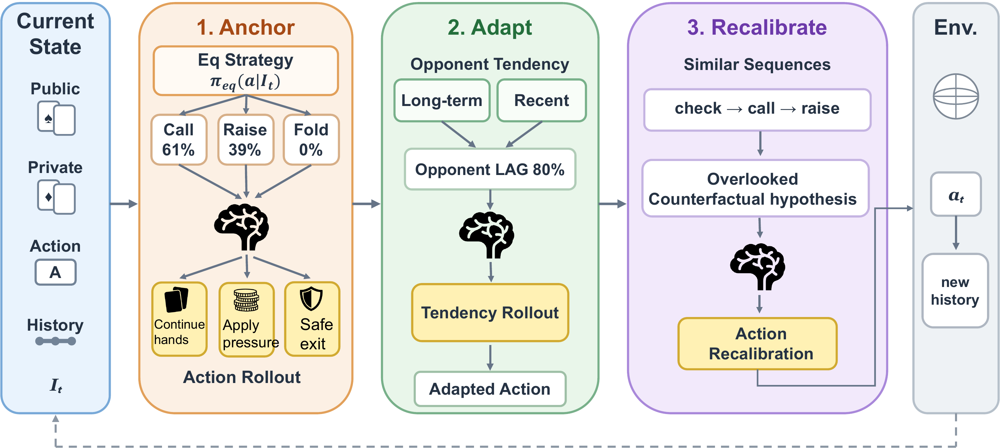
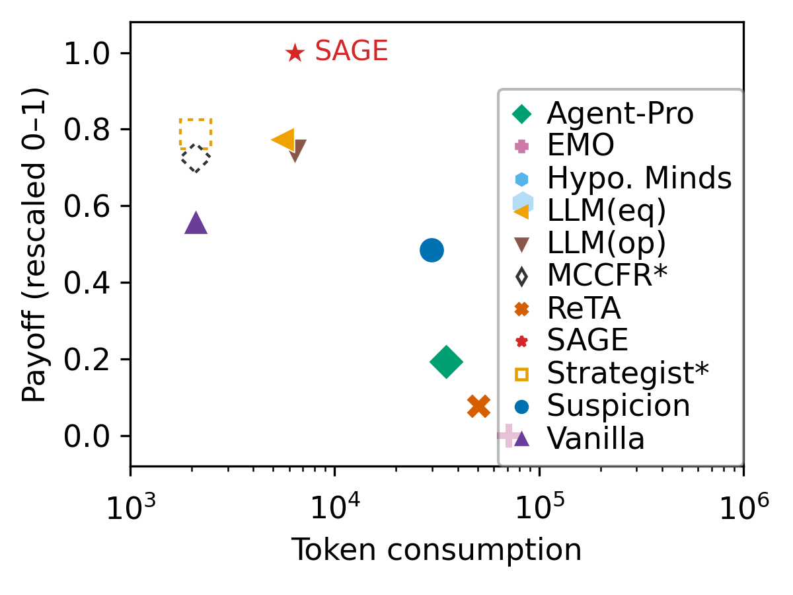
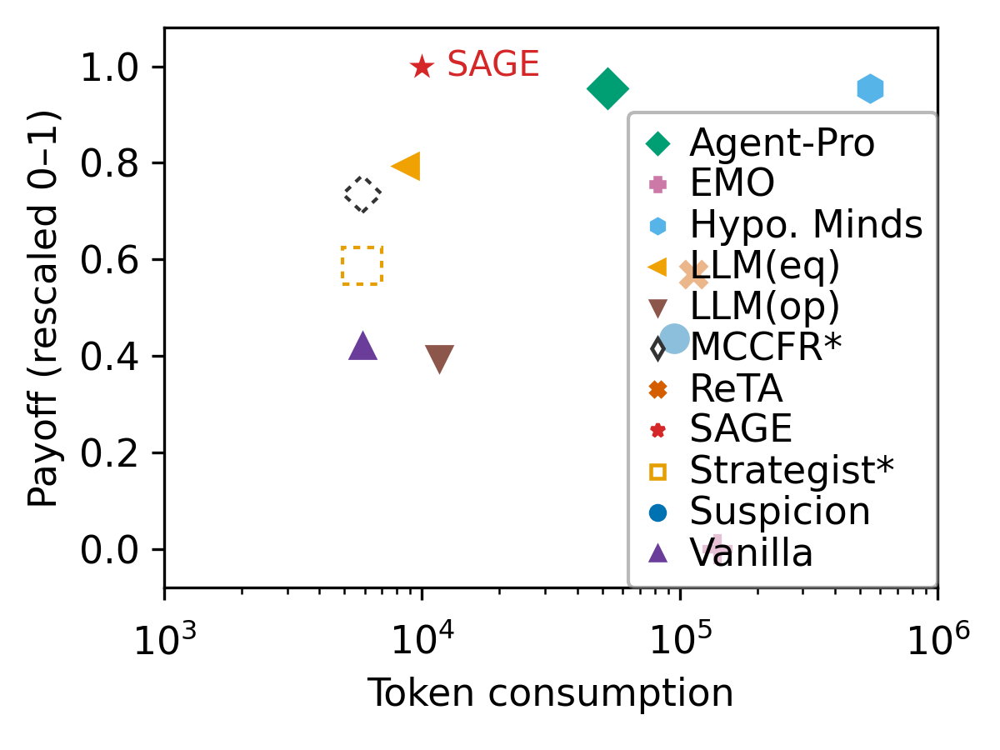
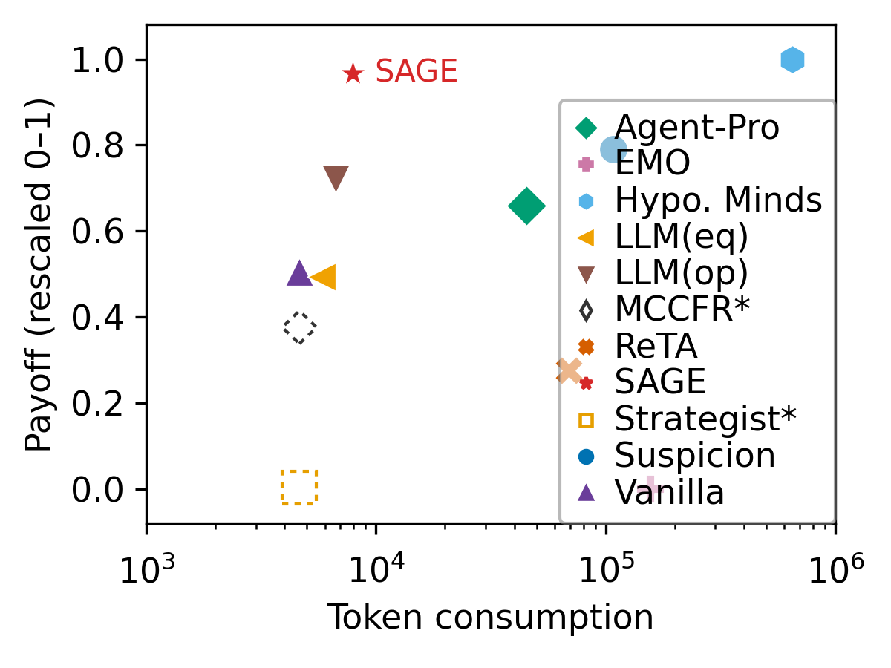

<div align="center">

<h3> SAGE: Structured Strategic Reasoning for Efficient LLM Game Playing</h3>

<p><a href="https://chenzhwsysu57.github.io/">Zhiwei Chen</a><sup>1</sup> &nbsp; Tianchun Wang<sup>2</sup> &nbsp; <a href="https://raozhongtao.github.io/">Zhongtao Rao</a><sup>1,3</sup><br>Haiming Zhu<sup>4</sup> &nbsp; Ding Cao<sup>5</sup> &nbsp; <a href="https://tianxiangzhao.github.io/">Tianxiang Zhao</a><sup>1,*</sup></p>

<p><sup>1</sup>The Hong Kong University of Science and Technology (Guangzhou)<br><sup>2</sup>Johns Hopkins University &nbsp; <sup>3</sup>Microsoft<br><sup>4</sup>Fudan University &nbsp; <sup>5</sup>University of Science and Technology of China<br><sup>*</sup>Corresponding author</p>

<p><a href="https://arxiv.org/abs/2609.34342"> 2609.34342</a> &nbsp; · &nbsp; <a href="https://github.com/chenzhwsysu57/SAGE"> SAGE</a></p>

</div>

<p align="center"><a href="Figures/framework.pdf"></a></p>

---

SAGE is a training-free, inference-time framework that structures LLM strategic reasoning around **anchor, adapt, and recalibrate** to make decision-making process more efficient and reliable:

- **Anchor** reasoning to an equilibrium policy as a strategically valid prior.
- **Adapt** deviations from that prior using a soft belief over opponent behavior.
- **Recalibrate** reasoning with counterfactual hypotheses distilled from strategically related past interactions.

**Our method is more token-friendly**

<p align="center"><a href="Figures/leduc_token_consumption.png"></a> <a href="Figures/liarsdice_token_consumption.png"></a> <a href="Figures/goofspiel_token_consumption.png"></a></p>

<p align="center">Payoff-token balance in Leduc Hold'em, Liar's Dice, and Goofspiel.</p>

**Supported games: Leduc Hold'em, Liar's Dice, Goofspiel**


**Supported agent methods**


| Method | Description |
| --- | --- |
| [Agent-Pro](https://aclanthology.org/2024.acl-long.292/) | Updates dynamic self/world beliefs, reflects on failed trajectories, then searches policy improvements with same-scenario verification and bounded DFS. |
| [EMO](https://aclanthology.org/2025.naacl-long.41/) | Maintains explicit natural-language opponent models through atomic and central feedback/refinement before a separate decision stage. |
| [Hypothetical Minds](https://arxiv.org/abs/2407.07086) | Learns and validates natural-language hypotheses about an opponent’s policy across games, then uses them to form a game-level strategy. |
| [ReTA](https://aclanthology.org/2024.naacl-long.123/) | Performs recursive look-ahead with main, anticipation, and reward actors, then selects actions with minimax backup. |
| [Strategist](https://arxiv.org/abs/2408.10635) | Evolves executable value heuristics with an idea library and population self-play, then applies observation-keyed MCTS. |
| [Suspicion](https://arxiv.org/abs/2309.17277) | Uses theory-of-mind reasoning to infer opponent behavior and guide planning from observations and interaction history. |


## Run it the vibe-coding way (recommended)

Just clone this repo and ask your Copilot, Codex, or Claude to install the dependencies for you and run SAGE or the supported baselines.

For example:

> Read the README and set up a single conda environment named SAGE with Python 3.11. Install the project and development dependencies, prepare the Leduc CFR+ baseline, then run SAGE with statistical opponent modeling against CallingStation. Preview the benchmark launcher with --dry-run before making API calls, start with one game per position, and use separate output directories. Read API credentials from environment variables; do not print them.

## Run it the manual way

### 1. Install dependencies

```bash
git clone https://github.com/chenzhwsysu57/SAGE.git
cd SAGE
conda create -n SAGE python=3.11 -y
conda activate SAGE
python -m pip install -e ".[dev]"
```

Set your OpenAI-compatible API credentials:

```bash
export OPENAI_API_KEY="<your-api-key>"
export OPENAI_BASE_URL="<your-api-base-url>"
```

Set the model with `--model` or `--model-name`, and the endpoint with `--base-url`.

### 2. Check the installation

```bash
pytest tests/ -q
python main.py --help
```

### 3. Train equilibrium baselines

Prepare the equilibrium baseline for your game. Use `--help` for training options.

```bash
# Leduc Hold'em CFR+
python runs/leduc/train_cfr.py --output-dir results/leduc/cfr_model

# Small Liar's Dice CFR+
python runs/liars_dice/train_cfr_2x3.py

# Goofspiel MCCFR
python runs/goofspiel/openspiel_mccfr_goofspiel.py --help
```


### 4. Run benchmarks

Benchmark results are saved under `results/`.

```bash
# Leduc ToM/SAGE ablations
python runs/leduc/leduc_tom_ablation.py --help

# Goofspiel benchmark
python runs/goofspiel/goofspiel_bench.py --help

# Liar's Dice ToM ablations
python runs/liars_dice/ld_tom_ablation.py --help

# Preview the Leduc baseline comparison without making API calls
bash ablation/run_leduc_vs_baselines.sh --dry-run
```

Summarize completed runs with [stats/benchmark_summary.py](stats/benchmark_summary.py):

```bash
python stats/benchmark_summary.py results/leduc/<experiment>/<run_id>
```

Run directory layout:

```text
results/<game>/<experiment>/<run_id>/
├── config.json
├── summary.json
├── trajectories/
├── metrics/
├── figures/
├── logs/
└── prompts/
```

### 5. AI vs human
There's also interface where you can play with the AI in games, for example, in Leduc game against CFR:

```bash
python main.py leduc \
  --p1 Human --p1-method human \
  --p2 CFR --p2-method cfr \
  --seed 42 \
  --verbose
```


## Citation

```bibtex
@misc{chen2026sage,
  title={SAGE: Structured Strategic Reasoning for Efficient LLM Game Playing},
  author={Zhiwei Chen and Tianchun Wang and Zhongtao Rao and Haiming Zhu and Ding Cao and Tianxiang Zhao},
  year={2026},
  eprint={2609.34342},
  archivePrefix={arXiv},
  url={https://arxiv.org/abs/2609.34342}
}
```

## License

The project code is released under the [MIT License](LICENSE).
