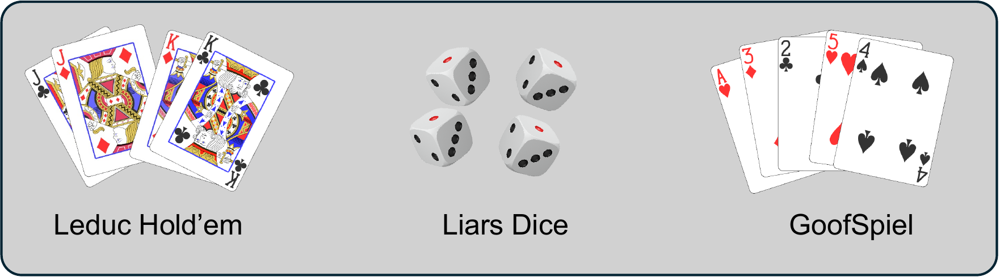

<p align="center">
  <a href="Figures/ban.pdf">
    
  </a>
</p>

# SAGE 🚀🚀🚀

An LLM agent that plays imperfect-information games which captures opponents' behavior tendencies and react over them!


**supported games**
✅ Leduc Hold'em
✅ Liar's Dice
✅ Goofspiel


## Quick Start

**Prepare the enviroment**

```bash
git clone
cd SAGE
conda create -n SAGE python=3.11 -y
conda activate SAGE
pip install -r requirements.txt

```

optionally, you can test whether the code runs correctly:
```bash
pytest tests/ -q
```

API preparation:

```
export OPENAI_API_KEY="<your key>"
export OPENAI_BASE_URL="<base url>"
```

**prepare the CFR model**
```bash
# Leduc Hold'em
python runs/leduc/train_cfr.py --help
python runs/leduc/train_cfr.py --output-dir results/leduc/cfr_model

# Small Liar's Dice setting
python runs/liars_dice/train_cfr_2x3.py --help
python runs/liars_dice/train_cfr_2x3.py

# Goofspiel MCCFR
python runs/goofspiel/openspiel_mccfr_goofspiel.py --help
```

**Option 1** : Human against Agent!

If you want to play against the LLM instead of letting'em self playing, you can try:

```bash
python main.py leduc \
  --p1 Human --p1-method human \
  --p2 CFR --p2-method cfr \
  --seed 42
```

Use `--verbose` if you want to inspect the trajectory after the game.

**Option 2**: Agents battlefield
To run the full benchmark, you can refer to the scripts below:

```bash
python runs/leduc/leduc_tom_ablation.py --help
bash ablation/run_leduc_vs_baselines.sh --dry-run
```

For lightweight benchmark summaries, use
[`stats/benchmark_summary.py`](stats/benchmark_summary.py). It reads completed
run `summary.json` files and prints performance rows; the full research
analysis and plotting pipeline is not included in the public repository.


Each recorded run should have this shape:

```text
results/<game>/<experiment>/<run_id>/
├── config.json
├── summary.json
├── trajectories/
├── metrics/
├── figures/
├── logs/
└── prompts/
```


## A quick look at the comparison 📊

The table below is the selected Leduc comparison reported in the manuscript
evaluation. It shows average P0 payoff per game in the 180-game evaluation
setting; it is included as a navigation aid, not as a replacement for the
full experimental record.

| Agent condition | Avg. P0 payoff/game |
| --- | ---: |
| Vanilla LLM | 1.56 |
| LLM + equilibrium guidance | 1.91 |
| LLM + opponent modeling | 1.86 |
| Suspicion baseline | 1.43 |
| **SAGE** | **2.28** |
